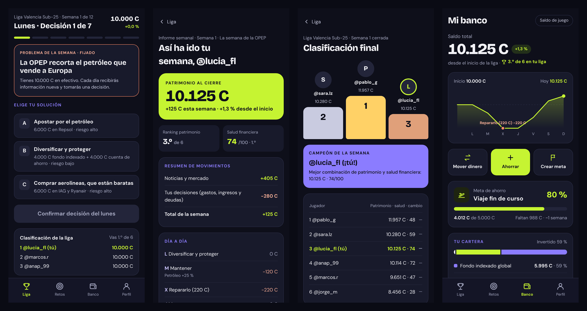
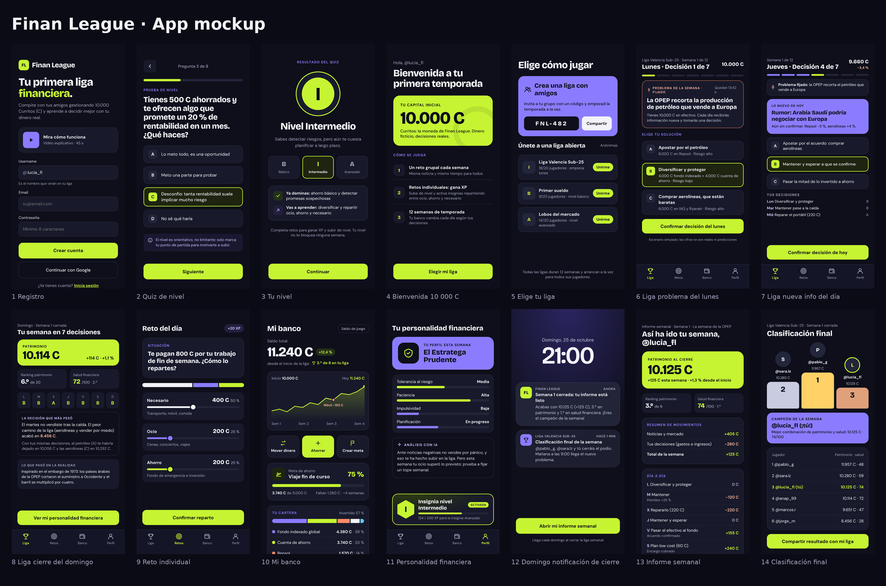

<p align="center">
  
</p>

# Finan League

**A weekly league where young people learn to decide with money, by playing with their friends.**

Finan League is a financial-education game for people aged 18 to 25 who have some savings but lack the habits and knowledge to manage them. Every player starts with **10,000 Curros (C)**, a fictional currency. Every Monday the whole league faces the same problem, inspired by a real event. Every day brings new information and one decision. On Sunday, each player gets a personal report and the league crowns the best decision-maker, not just the richest player.

> Project for the *Creación e Innovación* course · MBA, EDEM Escuela de Empresarios (Valencia, 2026).

---

## Play the prototype

| | |
|---|---|
| **Play on your phone** | [elenamoya-bit.github.io/finan_league](https://elenamoya-bit.github.io/finan_league/) |
| **Watch how it works (1 min 27 s)** | [video page](https://elenamoya-bit.github.io/finan_league/video.html) |
| **Scan to play** |  |

No sign-up and no install. Each player's progress is saved on their own device.

## How it works

1. **Sign up** with a username and take a five-question quiz that sets your starting level: basic, intermediate or advanced.
2. **Join a league** with friends (invite code) or an open league with players of your level.
3. **Monday:** the week's problem is pinned at the top, with three possible solutions.
4. **Tuesday to Sunday:** new information arrives every day and you make one decision. Seven decisions a week.
5. **Sunday:** a notification opens your weekly report (movements, analysis and your financial personality) and the league's final ranking.

Between league decisions, **personal challenges** (splitting a first paycheck, spotting a hidden cost, need or want) earn XP to level up and unlock level badges.

### Scoring

The champion is the player who best combines **net worth** and the **financial health index** (0–100):

| Indicator | Weight | What it measures |
|---|---|---|
| Saving | 25 % | Share of income kept each week |
| Emergencies | 25 % | Emergency fund, handling surprises without debt |
| Investing | 30 % | Diversification, sensible risk, no panic selling |
| Knowledge | 20 % | Correct challenges and understanding why things happened |

### Example weeks included in the prototype

| Week | Level | Inspired by |
|---|---|---|
| Inflation hits 10 % on food and transport | Basic | Spain, 2022 |
| OPEC cuts oil supply to Europe | Intermediate | Oil embargo, 1973 |
| Nvidia launches a breakthrough AI chip | Advanced | AI boom 2023–2024 and the 2021 chip shortage |

Each week has 3⁷ = 2,187 possible paths. The decision trees in [`docs/mockup`](docs/mockup) show how different paths change the starting 10,000 Curros.

## Repository contents

```
finan_league/
├── index.html          Playable mobile prototype (single file, no dependencies)
├── video.html          Page with the explainer video
├── assets/
│   ├── video.mp4       Explainer video (H.264)
│   ├── video.webm      Explainer video (VP9, fallback)
│   ├── poster.jpg      Video cover
│   └── qr-play.png     QR code to the prototype
└── docs/
    ├── FinanLeague-Pitch-Deck.pdf     Pitch deck (15 slides)
    ├── FinanLeague-Pitch-Script.pdf   Speaker script and Q&A
    ├── mockup/                        App mockup, screen by screen, and decision trees
    └── screenshots/                   Screenshots of the working prototype
```

## Documents

- **[Pitch deck](docs/FinanLeague-Pitch-Deck.pdf):** problem, solution, demo, brand, competitive advantage, business model, go-to-market, team, roadmap, costs and the ask.
- **[Pitch script](docs/FinanLeague-Pitch-Script.pdf):** speaker notes per slide and answers to tough questions.
- **[App mockup](docs/mockup/00-overview.png):** the 14 key screens, from sign-up to the Sunday ranking, plus three decision trees.

<p align="center">
  
</p>

## Technology

The prototype is a single, self-contained HTML file with plain JavaScript and CSS, published with GitHub Pages. A small simulation engine applies each day's market moves and each decision to the player's portfolio, which carries over from week to week, and updates the four health indicators. The other league members are simulated players who follow predefined paths.

## Team

| Name | Role |
|---|---|
| Elena Moya | Product & UX design |
| Alejandra Gascó | Strategy lead |
| Mateo Codoñer | Market research |
| Pablo Berenguer | Business model |
| Mikel Fernández | Innovation & ideas |

## Disclaimer

Finan League is an educational prototype. Curros have no monetary value and cannot be bought or cashed out. Scenarios are simulated: companies and countries are real so players recognise them, but the price changes are game parameters, not predictions or historical data. This is not financial advice.

© 2026 The Finan League team. All rights reserved.
